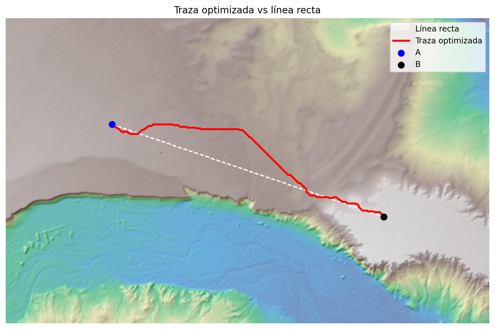

# Ruteo óptimo de un oleoducto de recolección en Loma Campana (Vaca Muerta)

Ejercicio de prefactibilidad: ¿por dónde conviene tender un ducto de recolección de unos 12 km entre el yacimiento Loma Campana y la Planta de Tratamiento de Crudo (PTC), en Añelo, Neuquén, minimizando pendiente, interferencias y nueva afectación de terreno?

Se resuelve con un algoritmo de **camino de costo mínimo** sobre una grilla raster de 30 m, usando solo datos públicos.

> **Aviso:** es un ejercicio académico/de portfolio con datos abiertos. No representa un proyecto, diseño ni traza de YPF ni de ninguna otra operadora, y no reemplaza ingeniería de detalle, estudios geotécnicos, ambientales ni de servidumbres.



## Resultados

| Métrica | Línea recta | Traza optimizada |
|---|---|---|
| Longitud | 11,77 km | 12,23 km (+3,9 %) |
| Desnivel acumulado, subida | 55,8 m | 55,9 m |
| Desnivel acumulado, bajada | 35,1 m | 35,2 m |
| Pendiente máxima | 5,3 % | 4,7 % |
| Pendiente media | 1,0 % | 0,9 % |
| Tramo a ≤150 m de caminos o ductos existentes | 51,9 % | 96,6 % |
| Metros dentro de zona edificada (*) | 627 m | 0 m |
| Cruces de rutas principales (**) | 6 | 2 |
| Cruces de cursos de agua mapeados en OSM | 0 | 0 |
| Índice de fricción acumulado (adimensional) | 18.904 | 309 |

(*) Edificios (con margen de 50 m) y usos de suelo residencial, comercial e industrial de OSM, excluyendo un radio de 400 m alrededor del origen y del destino.

(**) Rutas principales de OSM (autopista, troncal, primaria, secundaria y terciaria); los caminos de tierra de las locaciones no se cuentan.

**Lectura:** la línea recta recorre 627 m dentro del área edificada de Añelo. La traza optimizada la rodea por el norte, aprovecha el corredor de caminos existente y lo hace con ~460 m más de longitud (+3,9 %) y reduce los cruces de rutas principales de 6 a 2. Ninguna de las dos cruza cursos de agua mapeados en OSM, así que esa métrica no las diferencia.

El *índice de fricción* es la suma de los costos de celda a lo largo de la traza. Sirve para comparar alternativas entre sí; **no es un costo en dólares ni un ahorro de CAPEX.**

## Metodología

1. **Área de estudio:** rectángulo entre origen y destino con 4 km de margen, en UTM 19S (EPSG:32719), celdas de 30 m.
2. **Matriz de costos** (cada celda parte de 1):

| Factor | Regla |
|---|---|
| Pendiente | `+ (pendiente% / 5)²`; `+60` si > 15 %; `+500` si > 25 % |
| Corredor existente | `× 0,6` entre 30 y 150 m de caminos o ductos (paralelo y desplazado, no sobre la calzada) |
| Cruce de ruta principal | `+40` (tapada o perforación) |
| Cursos de agua | `+40` (buffer 15 m); costo alto pero finito, porque hay muchos arroyos secos que un ducto cruza |
| Zona edificada | `+1000` (edificios con buffer 50 m, y usos de suelo residencial, comercial e industrial) |
| Origen y destino | se libera la restricción urbana en un radio de 400 m, para poder entrar a las instalaciones |

3. **Ruteo:** camino de costo mínimo con conectividad de 8 vecinos (`skimage.graph.route_through_array`).
4. **Métricas y mapas:** longitud, desnivel, pendiente, porcentaje en paralelo a infraestructura; mapa estático con relieve sombreado y mapa interactivo (folium) con capa satelital.

## Datos y fuentes

| Dato | Fuente |
|---|---|
| Relieve | Copernicus DEM GLO-30 (30 m), AWS Open Data |
| Caminos, ductos, cursos de agua, edificios, usos de suelo | OpenStreetMap, vía Overpass API (`osmnx`) |
| Origen (yacimiento Loma Campana) | Coordenada del yacimiento según Global Energy Monitor: `-38.324, -68.831` |
| Destino (PTC) | Marcador "YPF Loma Campana - PTC" en Google Maps: `-38.3556, -68.7126` |

Atribuciones: *Contains modified Copernicus data*; © OpenStreetMap contributors (ODbL).

## Cómo reproducirlo

```bash
pip install -r requirements.txt
python ruteo_oleoducto.py            # descarga los datos y genera outputs/
python ruteo_oleoducto.py --synthetic  # prueba la lógica sin internet
```

Tarda varios minutos por las consultas a Overpass; el script prueba servidores espejo si alguno no responde. Genera `outputs/metricas.json`, `outputs/traza.png` y `outputs/mapa_interactivo.html`. Las coordenadas de origen y destino se cambian en la sección de configuración del script.

## Limitaciones

- **El DEM es un modelo de superficie (DSM):** incluye edificios y vegetación, y la resolución de 30 m suaviza escarpas y pequeños cañadones.
- **OpenStreetMap es incompleto:** en la zona hay 22 ductos mapeados; es probable que existan otros que no figuran, y los caminos de locación pueden estar desactualizados.
- **El porcentaje en corredor depende del modelo:** en un yacimiento hay caminos por todos lados y el descuento por corredor atrae a la traza hacia ellos. Con celdas de 30 m, el desplazamiento mínimo respecto del camino es una celda; no se modela el ancho real de la franja de servidumbre ni las distancias de seguridad a otros ductos.
- **Los cursos de agua se penalizan, no se modelan hidrológicamente:** no se evalúa socavación ni cruces especiales.
- **Los datos de OSM varían levemente según el servidor y la fecha de descarga.** Los resultados corresponden a la corrida del 15/10/2026.
- **Origen aproximado:** la coordenada del yacimiento es un punto representativo, no una locación (pad) de pozos específica.
- **Sin geotecnia, sin ambiental, sin hidráulica, sin servidumbres ni permisos.** Los pesos del modelo de costo son supuestos razonados, no calibrados con datos de obra.

## Posibles extensiones

- Modelar cruces de cauces con hidrología real (acumulación de flujo).
- Agregar restricciones ambientales y de uso del suelo con capas oficiales (IDE Neuquén).
- Comparar sensibilidad: variar los pesos y ver cuánto cambia la traza.
- Dimensionar el ducto (diámetro, espesor, pérdida de carga) sobre la traza resultante.
- Estimar movimiento de suelo a partir del perfil longitudinal.

## Estructura

```
.
├── ruteo_oleoducto.py
├── requirements.txt
├── README.md
└── outputs/
    ├── traza.png
    ├── mapa_interactivo.html
    ├── animacion_traza.gif / .mp4
    └── metricas.json
```
